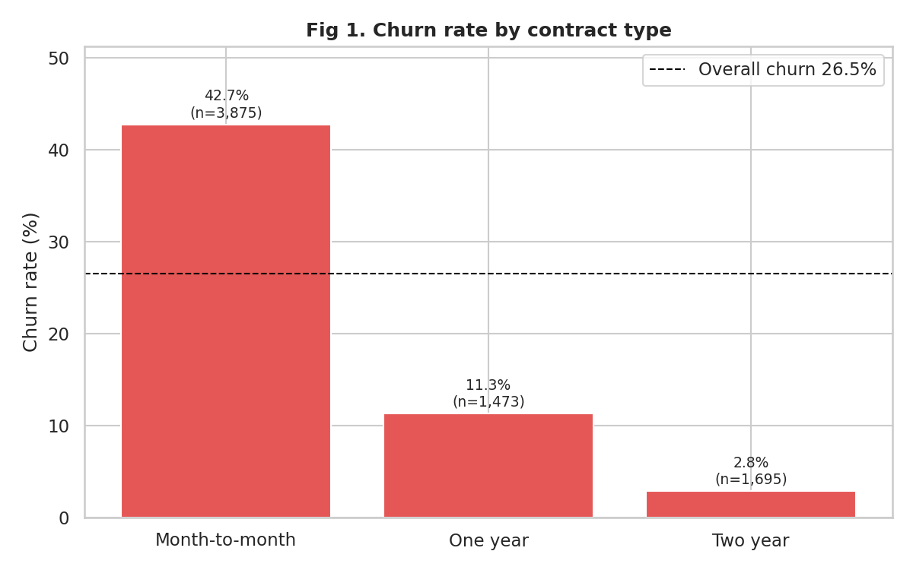
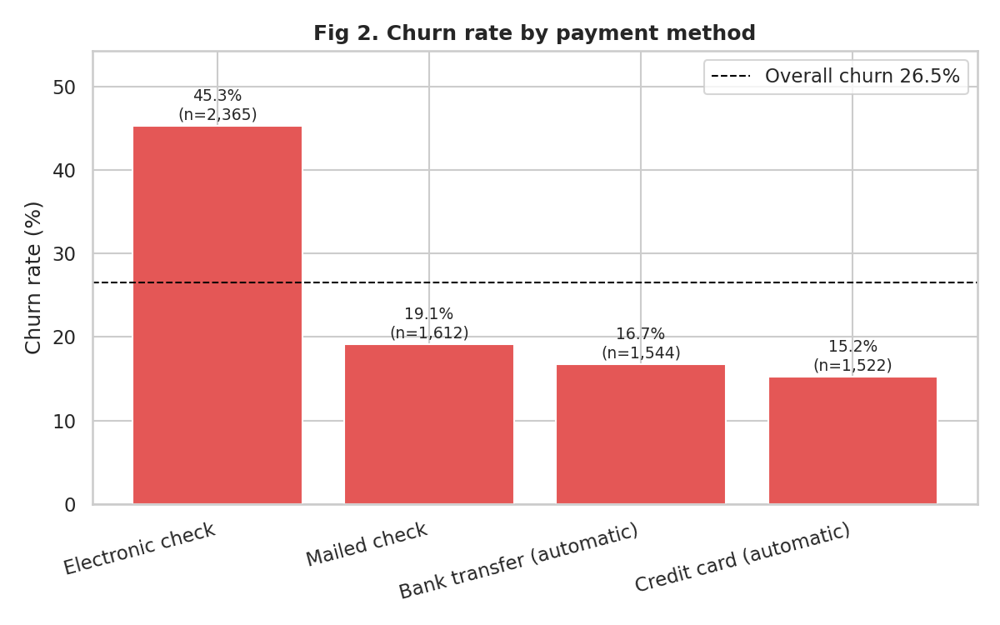
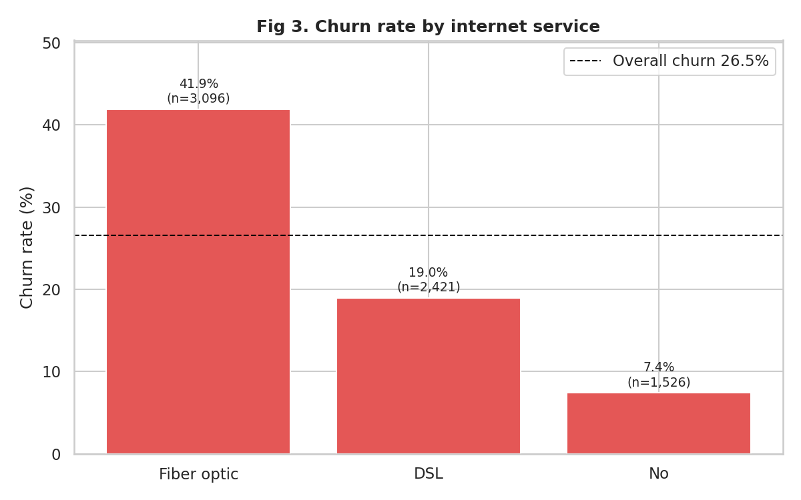
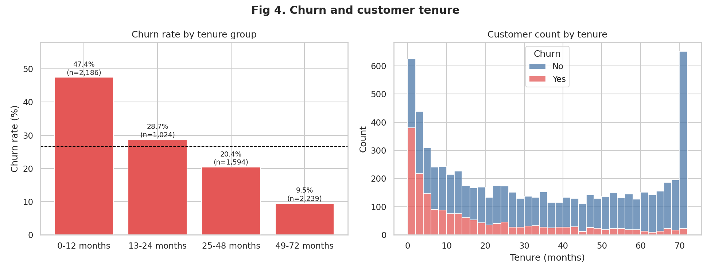
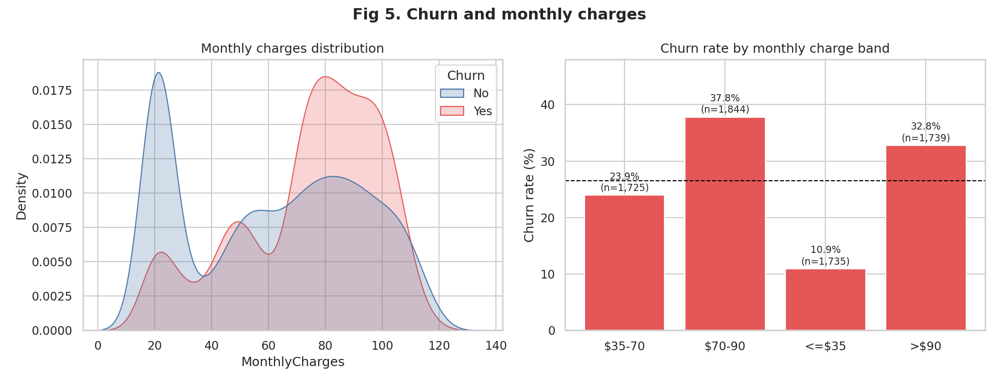
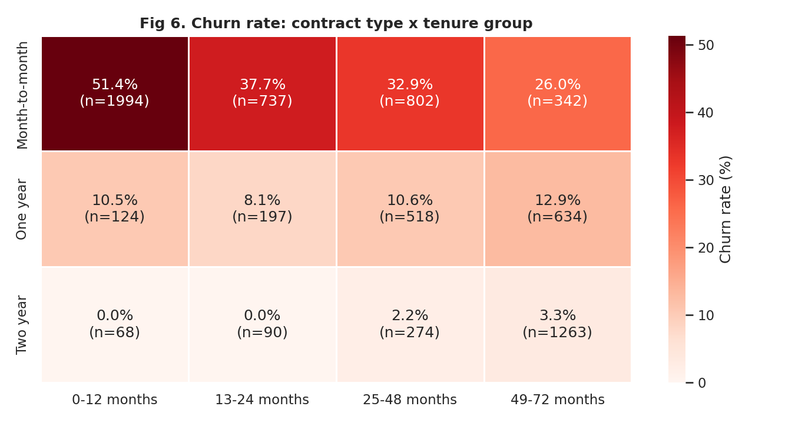
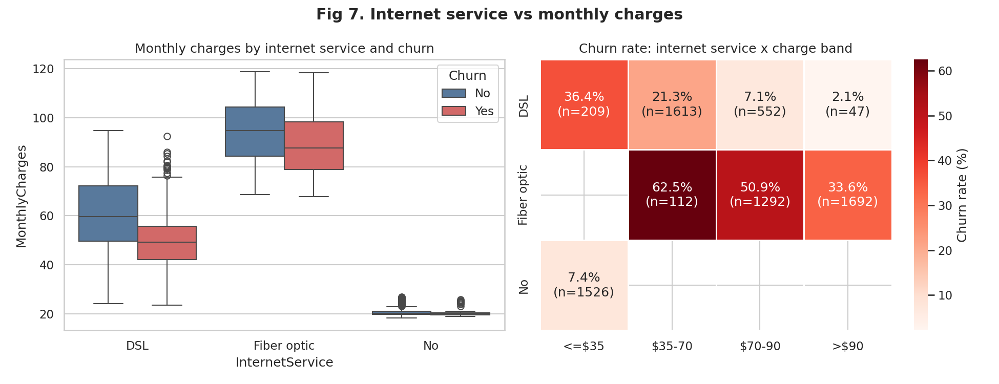
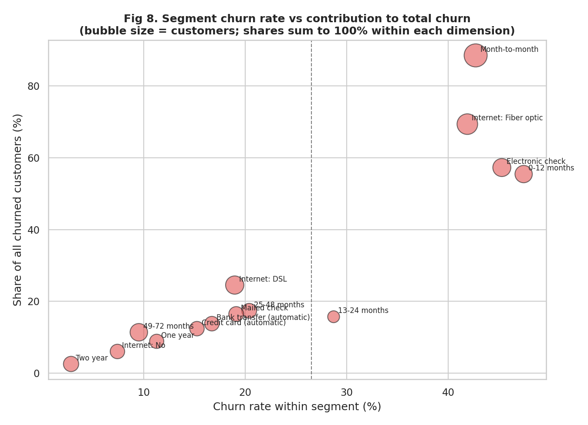

# Customer Churn Analysis (Telco)

Python analysis of which telecom customers leave, how much of the churn each segment is responsible for, and which retention actions to prioritize.

## 1. Business problem
A telecom provider loses 26.5% of its customers. Retention budget is limited, so management needs to know **who** churns most (churn rate), **where most churners come from** (contribution to total churn), and **what to do first**.

## 2. Objectives, tools, data
- **Objectives:** clean and validate the data, quantify churn, rank segments by rate and by contribution, give targeted recommendations.
- **Tools:** Python 3, pandas, matplotlib, seaborn.
- **Dataset:** IBM "Telco Customer Churn" sample dataset (7,043 customers, 21 columns), from [Kaggle](https://www.kaggle.com/datasets/blastchar/telco-customer-churn). Raw data is not included in the repo; see `data/raw/README.md`.
- **Data limitations:** one snapshot with no dates, no churn reasons, no satisfaction or network-quality fields, and it is a sample dataset that may not reflect a real operator.

## 3. Methodology
1. **Cleaning (`src/01_clean_data.py`):** checks types, missing values, duplicates, invalid values and category consistency. Found 11 blank `TotalCharges` values, all customers with tenure 0 (not yet billed), set to 0. No duplicates, no invalid values. Adds `ChurnFlag`, `TenureGroup` and `MonthlyChargesBand`. Full log: `outputs/data_validation_report.txt`.
2. **EDA and segments (`src/02_eda_segments.py`):** churn rate = churned / customers within a segment. Contribution = segment churners / all 1,869 churners. Each segment shows customer count, rate, share of churn and lift vs the overall rate. Cross-segments with fewer than 100 customers are excluded.
3. **Figures (`src/03_figures.py`):** the seven required figures plus one segment comparison chart.

## 4. Key results
Overall: **7,043 customers, 1,869 churned, 26.54% churn rate.**

| Segment | Customers | Churn rate | Share of all churn |
|---|---|---|---|
| Month-to-month contract | 3,875 | 42.71% | 88.55% |
| Fiber optic | 3,096 | 41.89% | 69.40% |
| Electronic check | 2,365 | 45.29% | 57.30% |
| Tenure 0-12 months | 2,186 | 47.44% | 55.48% |
| Month-to-month + fiber | 2,128 | 54.61% | 62.17% |
| Two year contract | 1,695 | 2.83% | 2.57% |

Full findings and recommendations: [`FINDINGS.md`](FINDINGS.md). Complete segment table: `outputs/segment_analysis.csv`.

### Recommendations (summary)
1. Convert month-to-month fiber customers to 12-month contracts, with a control-group test.
2. Run a first-year onboarding and check-in program.
3. Investigate fiber quality and value before cutting prices.
4. Move electronic check payers to autopay.
5. Trial bundled tech support and online security for at-risk internet customers.

## 5. Figures
| | |
|---|---|
|  |  |
|  |  |
|  |  |
|  |  |

## 6. Folder structure
```
customer-churn-analysis/
├── data/
│   ├── raw/            original CSV goes here (not modified, not committed)
│   └── processed/      telco_churn_clean.csv
├── src/                01_clean_data.py, 02_eda_segments.py, 03_figures.py
├── figures/            fig1 to fig8 (.png)
├── outputs/            validation report, summary tables, segment_analysis.csv
├── FINDINGS.md
├── requirements.txt
└── README.md
```