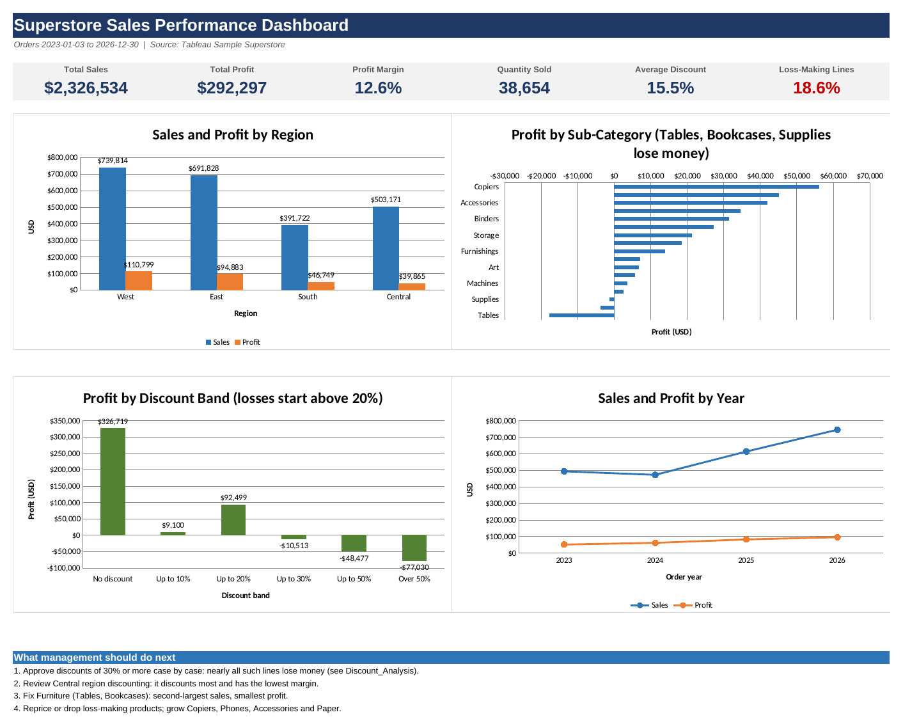

# Superstore Sales Performance Analysis (Excel)

An Excel analysis of which regions, categories and products drive sales and profit in a retail business, and how discounting relates to profitability.



## 1. Business problem
Management wants to know where profit is really coming from, which parts of the business lose money, and whether heavy discounting is hurting profitability.

## 2. Objectives, tools, data
- **Objectives:** build KPIs, PivotTable-style summaries by region, category, sub-category and product, a four-chart dashboard, and a discount/profit analysis with recommendations.
- **Tools:** Microsoft Excel (formulas: SUMIFS, COUNTIFS, AVERAGEIFS, RANK, CORREL; native charts). Workbook assembled with Python (openpyxl) so every analysis cell is a live formula.
- **Dataset:** Tableau "Sample - Superstore", Orders sheet: 10,194 order lines, orders dated 2023-01-03 to 2026-12-30. Source: https://public.tableau.com/app/learn/sample-data
- **Limitations:** sample data (not a real company); no cost or return analysis; Returns and People sheets were not used; average discount is a simple average across order lines.

## 3. Method
1. Checked the Orders data: no blank values, no duplicate rows or Row IDs, 10,194 rows kept.
2. Added two formula helper columns on the Data sheet: Order Year and Discount Band.
3. Built summary sheets with SUMIFS/COUNTIFS/AVERAGEIFS so everything recalculates from the Data sheet.
4. Built four charts on the Dashboard from those summary tables.
5. Verified 139 workbook values against an independent pandas calculation (`src/verify_numbers.py`, 0 mismatches). The workbook has 0 formula errors.

## 4. Workbook guide (`excel/Superstore_Sales_Performance.xlsx`)
| Sheet | Contents |
|---|---|
| About | Purpose, assumptions, limitations |
| Dashboard | 6 KPI cards, 4 charts, next steps |
| KPI_Summary | Total Sales, Total Profit, Profit Margin, Quantity Sold, Average Discount, loss-making lines, discount-profit correlation |
| Pivot_Region / Pivot_Category | Sales, profit, margin, quantity, discount, shares and ranks; region x category profit matrix; segment table |
| Pivot_SubCategory | 17 sub-categories sorted by profit, with status |
| Pivot_Product | Top 10 and bottom 10 products by profit |
| Pivot_Year | Yearly sales and profit |
| Discount_Analysis | Results by discount band, 30%+ discount metrics, discounting by region and category |
| Findings | 7 findings and 5 recommendations |
| Data | Original Orders data plus helper columns |

The `Pivot_` sheets are PivotTable-style tables built with formulas. To create native PivotTables, use Insert > PivotTable on the Data sheet.

## 5. Key results
- **Total:** $2,326,534 sales, $292,297 profit, 12.6% margin, 38,654 units, 15.5% average discount.
- **Regions:** West leads sales ($739,814) and profit ($110,799). Central has the lowest profit ($39,865, 7.9% margin).
- **Categories:** Technology (17.4% margin) and Office Supplies (17.2%) earn most profit. Furniture has $754,748 of sales but a 2.6% margin.
- **Sub-categories:** Copiers, Phones, Accessories and Paper lead profit. Tables (-$17,753), Bookcases (-$3,632) and Supplies (-$1,171) lose money.
- **Products:** 302 of 1,849 products lose money (-$77,600 in total).
- **Discounts:** lines with no discount earn a 29.6% margin; lines above 20% discount lose money in aggregate. 13.9% of lines carry a 30%+ discount and 96.8% of those lose money.

Full list: [FINDINGS.md](FINDINGS.md).

### Recommendations
1. Add an approval step for discounts of 30% or more, and test it on a subset first.
2. Review Central region discounting.
3. Fix Furniture profitability (Tables, Bookcases).
4. Reprice or drop loss-making products, starting with the Cubify 3D printers and Lexmark MX611dhe.
5. Protect and grow high-margin lines (Copiers, Phones, Accessories, Paper).

Discount findings show association only. Product mix also differs by discount band (for example most lines above 50% discount are Binders), so the data does not prove discounts alone cause the losses.

## 6. Folder structure
```
superstore-sales-analysis/
├── data/sample_-_superstore.xls      original Tableau sample file
├── excel/Superstore_Sales_Performance.xlsx
├── screenshots/dashboard.png
├── src/build_workbook.py             builds the workbook
├── src/verify_numbers.py             checks workbook values against pandas
├── FINDINGS.md
└── README.md
```

